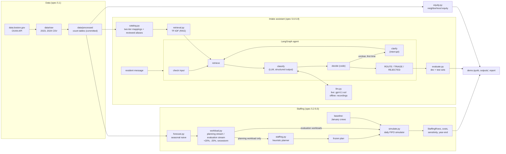

# DADS5250Group09
Midterm for John Baldwin, Nicholar Maar, Adam Jaroudi, and Andrew Lai: Option 2 Staffing Boston's 311 City Service Teams

<!-- [AI-authored: Claude] Sections below written by Claude; team to review. -->

**Boston 311 Crew Planner.** This builds a month-by-month 2025 crew plan for four Boston departments from real 2023 and 2024 311 data. It also includes a GenAI intake assistant that routes residents' plain-language messages to an official request type and department.

* **Departments:** Public Works, Transportation, Parks & Recreation, and Inspectional Services.
* **Results:** see the executed notebook [demo.ipynb](demo.ipynb) and the draft report [docs/report.md](docs/report.md).
* **Specification:** [docs/architecture.md](docs/architecture.md), the frozen design, plus the changes logged in [docs/decisions.md](docs/decisions.md).

This is a demonstration. It never submits anything to the City of Boston and never promises a completion date.

## Setup

Requires Python 3.12 (3.11 or later should work). From the repository root:

```bash
python -m venv .venv
```

Activate it (Windows: `.venv\Scripts\activate`; macOS or Linux: `source .venv/bin/activate`), then install the pinned dependencies and the package:

```bash
python -m pip install --upgrade pip
python -m pip install -r requirements.lock
python -m pip install -e . --no-deps
```

Register the environment as a Jupyter kernel named `boston311`, which is the kernel the notebook uses. With the virtual environment still active:

```bash
python -m ipykernel install --user --name boston311 --display-name "Python (boston311)"
```

`--user` makes the kernel visible to any Jupyter on your machine, for example one from Anaconda/Miniconda, as well as to VS Code. When you open `demo.ipynb`, check that the kernel shown at the top right is **Python (boston311)**. If it isn't, choose *Kernel > Change Kernel > Python (boston311)*. Running the notebook on any other Python fails with "No module named 'boston311'", because the package is only installed in `.venv`.

### Run it

* **No API key needed.** The default mode is `offline`, which replays the model answers recorded during the live run.
* **Execute the notebook from a fresh kernel:**

  ```bash
  python -m nbconvert --to notebook --execute --inplace demo.ipynb
  ```

* **Or run everything and write all tables, figures, and a run manifest to `outputs/`:**

  ```bash
  python scripts/run_all.py
  ```

* **Run the tests (about 100, no network or key):**

  ```bash
  python -m pytest -q
  ```

### Live mode (optional)

1. Copy `.env.example` to `.env` and set `OPENAI_API_KEY`. The `.env` file is gitignored.
2. Set `MODE = "live"` in the notebook's first code cell, or run `python scripts/run_all.py --mode live`.

Live mode calls `gpt-6.1-sol`, but only for inputs that have no recording yet.

### Rebuild the data (optional)

The small processed tables in `data/processed/` are committed, so nothing needs downloading. To rebuild them from the source:

```bash
python scripts/build_data.py
```

This fetches the 2023 and 2024 files (about 370 MB) through the [data.boston.gov](https://data.boston.gov/dataset/311-service-requests) CKAN API, verifies the checksums the city publishes, and writes the tables again. To rebuild the catalog after reviewing mappings: `python scripts/build_catalog.py`. Reviews and aliases are preserved.

**Note for Windows machines with antivirus HTTPS scanning:** the package uses `truststore`, so Python trusts the operating system's certificates. Very old pip versions may still fail to install packages there. Upgrade pip first, as shown above.

## Architecture



| Module | What it does |
|---|---|
| `config.py` | Every GIVEN rule and DEFAULT parameter, plus paths and model settings, in one place |
| `data.py` | API fetch with checksum check, cleaning, target classes, and committed aggregate tables |
| `forecast.py` | Seasonal naive 2025 forecast and a 2023-to-2024 backtest |
| `workload.py` | Exact largest-remainder arrivals, seeded deadlines, and coupled scenarios |
| `simulate.py` | Synthetic 21-day calendar; FIFO queue whose state is one integer; penalty events |
| `staffing.py` | Heuristic planner, frozen-plan replay, cost accounting, year-end report, reconciliation checks |
| `catalog.py` | Official request types, two-tier routing mappings, provisional reviews, aliases, statistics |
| `retrieval.py` | TF-IDF search (words plus character fragments) |
| `llm.py` | LangChain `ChatOpenAI` with strict structured output, bounded retries, record and replay |
| `agent/` | LangGraph intake graph (`graph.py`), its steps (`nodes.py`), and helpers (`tools.py`) |
| `evaluate.py` | Intake metrics: accuracy, auto-route precision and coverage, clarification and triage rates |
| `equity.py` | Mix-adjusted neighborhood on-time comparison (added module) |
| `manifest.py` | One JSON manifest per run: input checksums, parameters, seeds, versions |

Course techniques used: **prompt engineering**, **structured output** (Pydantic + strict JSON schema), **RAG** (retrieval over the official catalog), **LangChain**, and a **LangGraph agent** with an interrupt-based clarification. No other agent frameworks are used.

## Team contributions

| Member | Role |
|---|---|
| John Baldwin | Technical build; planning-year, package-plus-notebook, and reference-notebook decisions |
| Adam Jaroudi | Technical build |
| Nicholas Maar | Project selection; report and video |
| Andrew Lai | Report and video |
| Claude (AI, Anthropic) | Wrote the architecture spec with Codex review, the code, tests, eval sets, notebook, and report draft. See [docs/authorship.md](docs/authorship.md) |

## Reference material

The team chose two GenAI_Agents tutorials as reference notebooks: the [Customer Support Agent](https://github.com/NirDiamant/GenAI_Agents/blob/main/all_agents_tutorials/customer_support_agent_langgraph.ipynb) and the [Contextual Quoting System](https://github.com/NirDiamant/GenAI_Agents/blob/main/all_agents_tutorials/contextual_quoting_agentic_system.ipynb). Their repository uses a [custom non-commercial license](https://raw.githubusercontent.com/NirDiamant/GenAI_Agents/main/LICENSE) that requires attribution. This build does not copy code from them.

Data: City of Boston, [311 Service Requests](https://data.boston.gov/dataset/311-service-requests), Analyze Boston (public domain).
